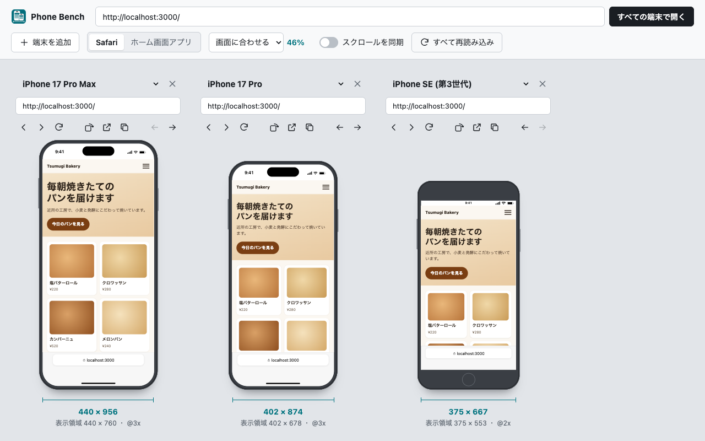

# Phone Bench

localhost の開発サーバーや公開中のページを、複数の iPhone の画面に並べて同時に確認する Chrome 拡張機能です。



## できること

- 確認したいページでツールバーのボタンを押すと、並んだ iPhone すべてにそのページを表示します
- 端末ごとに別の URL を開けます（本番と開発中の画面を並べて比べる、など）
- 機種は iPhone 17 Pro Max から iPhone SE（第3世代）まで10種類。最大12台を並べられます
- Safari 表示とホーム画面アプリ表示、縦向きと横向きを切り替えられます
- スクロールの同期、端末ごとの戻る・進む・再読み込みができます
- 「画面に合わせる」倍率では全端末を同じ倍率で表示するので、画面の大きさの違いもそのまま比べられます

`localhost:3000` のようにスキームを省いて入力できます。ローカルのホスト（localhost・127.0.0.1・192.168.x.x・*.local・*.test など）は http、それ以外は https で開きます。

## 開発

```bash
npm install
npm run build      # dist/ を作る
npm run test       # 単体テスト（Vitest）
npm run e2e        # dist/ を Chromium に読み込んで表示まで確かめる（Playwright）
npm run release    # 型チェック・テスト・ビルド・zip 作成をまとめて実行
```

Chrome で `chrome://extensions` を開き、デベロッパーモードで「パッケージ化されていない拡張機能を読み込む」から `dist/` を選ぶと試せます。

ストアへ上げる zip は `npm run zip` で `dist/` の中身だけから作ります（`public/` を含めると manifest が重複して弾かれます）。

## 仕組みと制限

[docs/spec.md](docs/spec.md) にまとめています。表示は Chrome の描画エンジンのままなので、Safari 固有の描画差は再現できません。最終確認は実機で行ってください。
